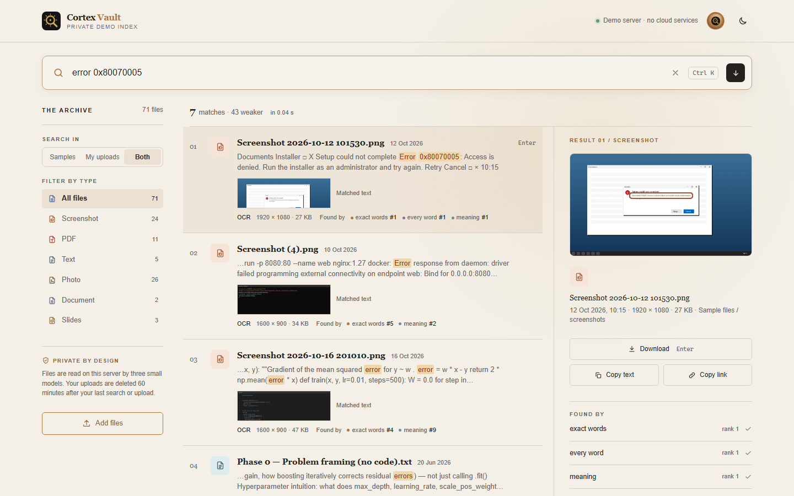
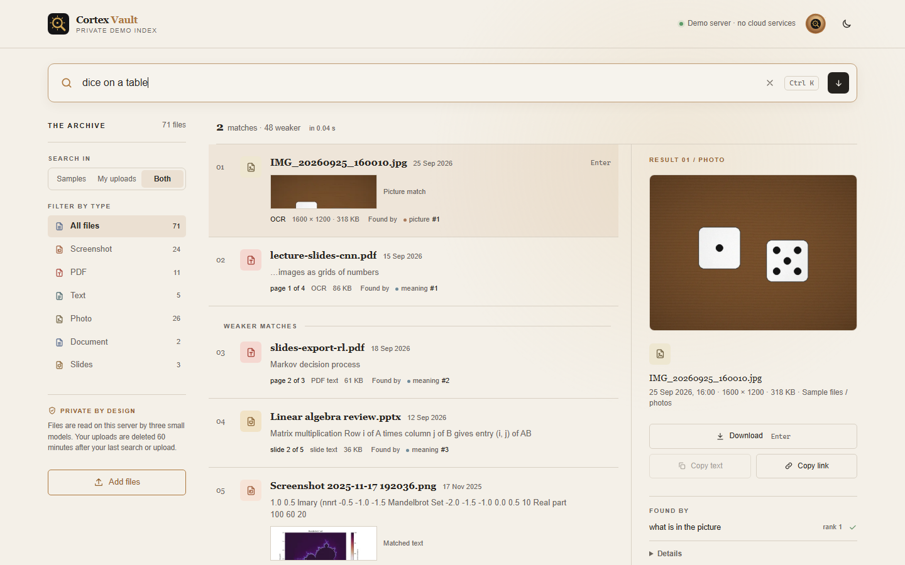
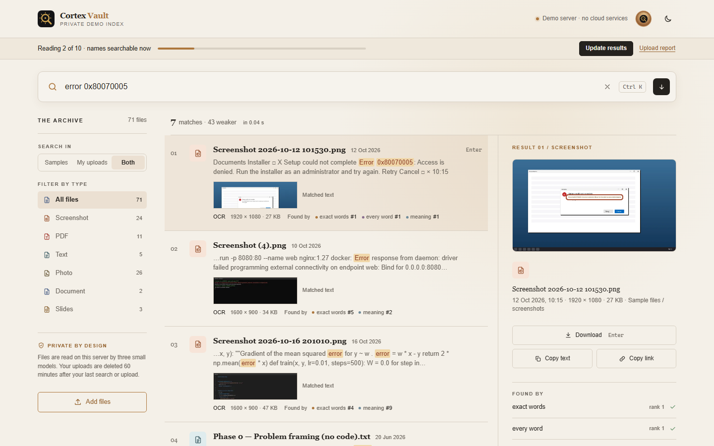
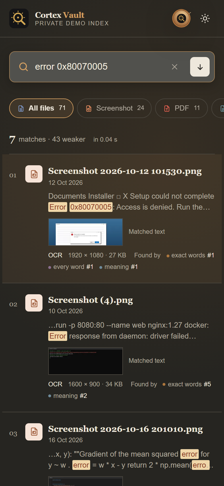
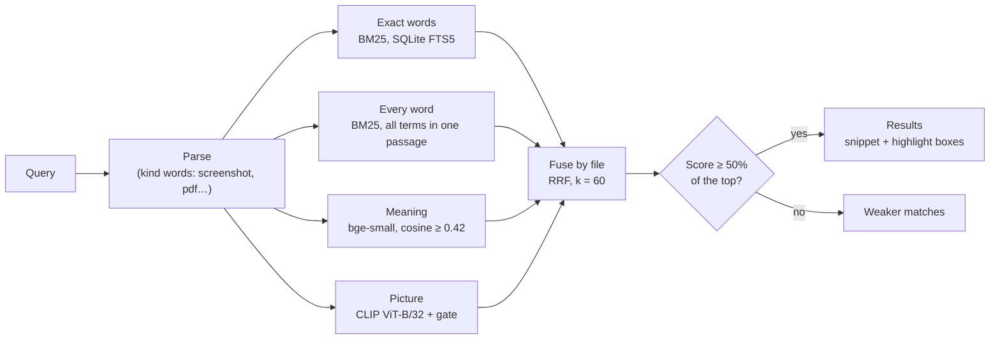

# Cortex Vault (Personal Search Vault)

Search your own screenshots, photos, PDFs, Word and PowerPoint files in plain language, on your own computer. Cortex
Vault reads the text in every file (with OCR for images and scanned pages), understands what a sentence means, and
looks at what is in each picture, using three small models that run on the CPU. Nothing is sent to a cloud service.

**Live demo:** https://swarup-vault.indiasouthcentral.cloudapp.azure.com/ searches 71 sample files: 52 generated
ones and 19 of the author's own. You can add your own files to search them alongside; they stay on the demo server,
are kept only for your session and are deleted 60 minutes after your last search or upload.

| Results, with the matched text highlighted in the preview | A picture found by what it shows |
|---|---|
|  |  |
| **Uploading your own files: searchable by name at once, then by content** | **On a phone, dark theme** |
|  |  |

## How search works

Each query runs through four ranked lists of files, and Reciprocal Rank Fusion merges them:

- **Exact words:** BM25 over SQLite FTS5 (Porter stemming); stopwords are dropped when a content word remains.
- **Every word:** the same BM25, restricted to passages that hold every content word of the query, so a file with
  the whole query in one place beats a file that repeats one word.
- **Meaning:** cosine similarity between the query and each passage, with
  [bge-small-en-v1.5](https://huggingface.co/BAAI/bge-small-en-v1.5). Passages below a similarity floor (0.42) are
  left out.
- **Picture:** CLIP ViT-B/32 compares the query with every image. A gate keeps only the clear matches: images scoring
  at least 2 standard deviations above the mean of all candidates (or, with fewer than 20 images, the top 5 above a
  floor). When no file holds every word and CLIP's best image is a strong outlier, the *visual-query rule* gives that
  image extra weight: "dice on a table" puts the photo of dice first, though no text in it says so.

Each list holds up to 100 files, ranked by their best passage, so one long book can't fill a list. Fusion adds
1 / (60 + rank) from each list a file appears in. Results that score under half of the top result's score go below
a **Weaker matches** divider, followed by the files that only the meaning floor or the picture gate kept out, so the
list is never cut short. Each result shows the passage or page that best matches, with the query words marked, and,
for screenshots and scans, boxes around the matching words in the preview.



Indexing reads each file once: names and native text (PDF text layers, Word, PowerPoint, text files) are searchable
within seconds; OCR (RapidOCR, PP-OCRv6), meaning vectors and picture vectors follow in a second pass. Files are
identified by content (SHA-256), so renamed, moved and duplicate files aren't read twice.

## Results

### Retrieval quality

44 queries written by the author before any search, over 95 files: the 52 generated files, 19 of the author's own
public files and 24 private ones (kept out of this repository; queries about them are reported by id only).
A correct file at rank 1, in the top 5 and in the top 10 (Recall@k), and MRR@10. The queries were split in half
with a fixed seed: the tuning half was used to choose settings, and the held-out half was run once with the final
settings ([`eval/results.md`](eval/results.md)), plus once more for the divider's numbers only after its rule
changed (the ranking was identical).

| Queries | n | R@1 | R@5 | R@10 | MRR@10 |
|---|---|---|---|---|---|
| All | 44 | 24 (55%) | 32 (73%) | 36 (82%) | 0.627 |
| Held-out half | 22 | 7 (32%) | 13 (59%) | 16 (73%) | 0.443 |
| Tuning half | 22 | 17 (77%) | 19 (86%) | 20 (91%) | 0.812 |
| Public files | 13 | 6 (46%) | 6 (46%) | 8 (62%) | 0.479 |
| Private files | 31 | 18 (58%) | 26 (84%) | 28 (90%) | 0.690 |
| Exact word | 9 | 7 (78%) | 9 (100%) | 9 (100%) | 0.856 |
| Meaning | 19 | 10 (53%) | 13 (68%) | 15 (79%) | 0.601 |
| Picture | 10 | 5 (50%) | 6 (60%) | 7 (70%) | 0.561 |
| Inside a scan | 6 | 2 (33%) | 4 (67%) | 5 (83%) | 0.479 |

What each list adds (all 44 queries, R@5 / R@10): exact and every word alone 24 / 25, meaning alone 27 / 34,
picture alone 22 / 29, words + meaning 25 / 31, all three with the picture gate (the app) 32 / 36. Without the gate
the picture list adds more noise than it finds: 30 / 34. A separate set of 32 queries about the generated files,
used only as a guardrail while tuning: 28 (88%) / 32 (100%) / 32 (100%), MRR 0.927.

The held-out half is the honest number, and it is lower: 4 of its 6 queries without a correct file in the top 10
describe abstract plots (fractals, complex-function plots) whose only text is axis numbers (see Known limitations).

### Scale test

1,000 generated files in [`bench/bench_upload.py`](bench/bench_upload.py)'s mix (300 desktop and 100 phone
screenshots, 250 camera-size photos, 100 PDFs with a text layer, 30 scanned and 20 slide-style PDFs, 80 Word, 60
PowerPoint and 60 text files; 1,146.8 MB), indexed with the demo's 71 files on the demo server under `nice -n 19`,
with the live demo running ([`bench/bench_scale.py`](bench/bench_scale.py),
[`eval/results_scale_vm.json`](eval/results_scale_vm.json)):

| Measure | Demo server, 1,071 files |
|---|---|
| Searchable by name and native text | 86 s |
| Fully read | 2,059 s (34.3 min), 0 errors, 6,914 passages |
| Time by stage | OCR 1,622 s (881 images and pages), meaning vectors 216 s, text extraction 148 s, CLIP 75 s, database writes 37 s, thumbnails 15 s |
| On disk | database 25.4 MB, thumbnails 6.0 MB |
| Peak RAM of the indexing process | 2,318 MB |
| Search, 45 public queries × 3 | p50 136 ms, p95 175 ms |

While it indexed, the live demo answered in 0.07–0.11 s (0.03–0.04 s idle).

**Quality at scale.** The same 1,000 files mixed into the 95 evaluation files, all queries run again on the laptop
([`eval/results_scale.md`](eval/results_scale.md)); nothing was tuned on it:

| Queries | R@1 | R@5 | R@10 | MRR@10 | Results above the divider (median) |
|---|---|---|---|---|---|
| All 44, 95 files → 1,095 files | 24 → 17 | 32 → 28 | 36 → 36 | 0.627 → 0.503 | 19 → 10 |
| Held-out half (22) | 7 → 5 | 13 → 13 | 16 → 17 | 0.443 → 0.395 | 19 → 9.5 |
| Generated-file set (32) | 28 → 26 | 32 → 29 | 32 → 31 | 0.927 → 0.855 | 9.5 → 4.5 |

Recall@10 holds; the top of the list gets worse. The files that moved above the correct ones are the evaluation's own
screenshots, not the new files: with 713 images instead of 63, CLIP's best image passes the visual-query rule's
outlier test far more often, so the rule fires on text queries (on 12 of the 17 tuning-half queries that aren't
picture queries, against 1 of 17 without the extra files). That is the known limitation below.

### Speed

Search time is the sum of the search engine's stage timers (parse, the four lists, fusion, snippets), the number the
UI shows as "in 0.04 s".

| Where | Index | Queries | p50 | p95 |
|---|---|---|---|---|
| Laptop (Windows, CPU only) | the 95 evaluation files, including a 4,000-passage textbook | the 44 queries | 188 ms | 258 ms |
| Laptop (Windows, CPU only) | the same plus the 1,000 generated files | the 44 queries | 232 ms | 406 ms |
| Demo server (4 vCPUs) | the 71 demo files plus the 1,000 generated files | 45 public queries, 3 times each | 136 ms | 175 ms |

The live demo answered "error 0x80070005", "Mandelbrot fractal" and "complex plane with real and imaginary axes" in
0.03–0.04 s. Uploads on the demo server (an Azure D4as_v4: 4 vCPUs, 16 GB RAM), timed with
[`bench/bench_upload.py`](bench/bench_upload.py) from the moment the files reach the server:

| Upload | Size | Searchable by name and native text | Fully read (OCR, meaning, pictures) |
|---|---|---|---|
| 100 mixed files | 115 MB | 8.0 s | 208 s |
| 200 mixed files | 229.5 MB | 16.9 s | 413 s (6.9 min) |

Indexing speed by file type, on the demo server during the scale test (files per second; PDFs include scanned
ones, which are OCR'd page by page): text and Word 5.2, PowerPoint 8.8, PDF 0.20, photo 1.09, screenshot 0.48.

## Privacy

- **Local models.** Text, meaning and picture models run on the CPU with ONNX Runtime. The only network access is the
  first-run download of the models from the Hugging Face Hub; after that it works offline (`HF_HUB_OFFLINE=1`).
- **No cloud calls.** No file, text or query is sent to any service. The app doesn't log queries, in either mode;
  recent searches are kept in your browser only.
- **The demo's rules:** at most 5 upload sessions at once; per session 200 files, 500 MB in total and 50 MB per file;
  uploads are deleted 60 minutes after the session's last search or upload. Files are served by database id or
  session id only, never by a path a visitor supplies. A session is created only by an upload, never by visiting or
  searching. The demo's 19 real files were checked for personal data before they were added, and images carrying GPS
  data are refused when the demo index is built.

## Known limitations

- **Messy handwriting.** The OCR models read print. On generated pages they read printed text with a mean confidence
  of 0.87–0.99 and handwriting-like scribbles with 0.50–0.58; a PDF whose first 3 pages with ink read below 0.72
  stops being OCR'd, so a handwritten notebook is found mostly by its name and what OCR made of its first pages.
- **Abstract plots.** Queries that describe a mathematical plot in words ("a dark central shape surrounded by
  intricate purple branching boundaries") are the weakest group: none of the 5 public held-out queries of this kind has its
  file in the top 5 (ranks 9, 12, 14, 21 and not found). Such images have little text beyond axis numbers, and CLIP
  ranks them only moderately.
- **The visual-query rule can fire on a text query.** When CLIP's best image looks like a strong outlier, the rule
  lifts it above a page that holds the query's text. On the 95 evaluation files it fired on 1 of the 17 tuning-half
  queries that aren't picture queries; with 1,000 more files in the index, on 12 of 17, which is most of the drop in
  R@1 at scale. Its outlier test was calibrated on 36 and 200 images. Fixing it needs a design change, not a
  threshold, and is planned.
- **No date queries.** "Screenshots from last week" searches for those words; it doesn't filter by date. Kind words
  (screenshot, photo, pdf, slides, notes) do filter.
- **Supported files:** PNG, JPEG and WebP images (HEIC with the optional `pillow-heif`), PDF, `.docx`, `.pptx`,
  `.txt` and `.md`. No video, audio, email, `.doc`, `.ppt` or `.xlsx`, and the demo doesn't accept `.zip` uploads.
- **Screenshot or photo.** A file named like a screenshot, or a photo with camera EXIF, is classified by that; other
  images are classified by CLIP, which on the author's real screenshots (plots and textbook pages, not app screens)
  doesn't recognise them as screenshots on its own (0 of 12).

## Run it locally (Windows)

Python 3.12, CPU only.

```bat
py -3.12 -m venv .venv
.venv\Scripts\activate
pip install -r requirements.txt

python -m vault index "C:\Users\you\Pictures\Screenshots" "C:\Users\you\Documents"
python -m vault search "error 0x80070005"
python app.py
```

`python app.py` serves the UI at http://127.0.0.1:7860. Indexing is incremental: run `index` again to pick up new,
changed, moved or deleted files. The first run downloads the models (about 650 MB) into `data/models/`; the index
lives in `data/`. It also runs on Linux, as the demo server does (`source .venv/bin/activate`).

Tests:

```bat
pytest -q                 :: everything
pytest -q -m "not slow"   :: skip the tests that load real models
```

Evaluation and benchmarks: `python -m vault eval` (needs the private files for the full set; the public queries are
in `eval/`), and the scripts in [`bench/`](bench/README.md).

## Models and libraries

| Model | Used for | Licence (source) |
|---|---|---|
| [Qdrant/bge-small-en-v1.5-onnx-Q](https://huggingface.co/Qdrant/bge-small-en-v1.5-onnx-Q), a quantised ONNX port of [BAAI/bge-small-en-v1.5](https://huggingface.co/BAAI/bge-small-en-v1.5) | Meaning (384-d text vectors) | MIT (both model cards) |
| [Qdrant/clip-ViT-B-32-vision](https://huggingface.co/Qdrant/clip-ViT-B-32-vision) and [-text](https://huggingface.co/Qdrant/clip-ViT-B-32-text), ONNX ports of [sentence-transformers/clip-ViT-B-32](https://huggingface.co/sentence-transformers/clip-ViT-B-32) | Picture search, screenshot or photo | MIT (Qdrant's model cards; the sentence-transformers card states none) |
| PP-OCRv6 det small, PP-OCRv6 rec small, ch_ppocr_mobile_v2.0_cls, shipped in the `rapidocr` wheel | OCR | Apache-2.0 (RapidOCR's `MODEL_LICENSES.md`; weights from PaddleOCR, Baidu) |

| Library | Version | Licence (package metadata) |
|---|---|---|
| fastembed | 0.9.0 | Apache-2.0 |
| onnxruntime | 1.31.0 | MIT |
| rapidocr | 3.10.0 | Apache-2.0 |
| PyMuPDF | 1.28.2 | AGPL-3.0 or Artifex commercial licence |
| python-docx | 1.2.0 | MIT |
| python-pptx | 1.0.2 | MIT |
| Pillow | 12.3.0 | MIT-CMU |
| NumPy | 2.5.4 | BSD-3-Clause AND 0BSD AND MIT AND Zlib AND CC0-1.0 |
| Gradio | 6.30.0 | Apache-2.0 |
| FastAPI | 0.143.2 | MIT |
| Uvicorn | 0.54.0 | BSD-3-Clause |
| Rich | 15.0.0 | MIT |
| pytest | 9.1.1 | MIT |

PyMuPDF is used under the AGPL-3.0, whose section 13 asks a network service built on it to offer its users the
source code.

## How it was built

Cortex Vault was built between 16 and 19 October 2026 from [SPEC.md](SPEC.md), the single source of truth, one
milestone per session,
with [Claude Code](https://claude.com/claude-code): M0 scaffold and deploy probe, M1 text pipeline, M2 OCR, M3
photos, CLIP and metadata, M4 UI and first deploy, M5 speed and visual polish, M6 real files and the evaluation.
Each change came with a test on generated files (506 tests today), and every threshold was first calibrated on
generated data with a script in [`bench/`](bench/README.md), marked provisional, and tuned only on the tuning half
of the evaluation queries. The decisions, with what was measured and why, are logged in SPEC §19.
